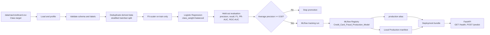

# Credit Card Fraud Detection — Architecture

## Component responsibilities

| Component | Responsibility |
|---|---|
| `data/raw/creditcard.csv` | Immutable source dataset; `Class` is the target (`0` normal, `1` fraud) |
| `01_load_data.py` / `02_validate_data.py` | Profile data and validate required schema/target constraints |
| `03_preprocessing.py` / `04_validate_outputs.py` | Remove exact duplicates from derived data, split without leakage, fit scaler on train, and validate arrays |
| `05_train_registry.py` | Fit the configured Logistic Regression, save local artifacts, log the model, and register it in MLflow |
| `06_model_evaluation.py` / `07_quality_gate.py` | Evaluate held-out data, log metrics to the training run, and gate on average precision |
| `08_automate_lifecycle.py` | Assign MLflow alias `production` after the gate and update the local registry manifest |
| `09_inference.py` | Produce predictions from the selected local Production model |
| `10_failure_injection.py` | Inject safe, reversible failures and verify detection |
| `11_prepare_deployment.py` | Copy model/preprocessor to `deployment/` and verify artifacts reload |
| `api/main.py` | Load the deployment bundle and serve numeric transaction features |
| `mlflow.db`, `mlruns/` | Project-local tracking and registry data; kept separate from Customer Churn |

## Data flow and evaluation

The raw dataset has 284,807 rows and 31 columns, including 30 numeric features and target `Class`. The preprocessing stage removes 1,081 exact duplicates only from derived data, then creates a stratified 80/20 split (226,980 train, 56,746 test). Scaling is fitted on training data only.

The final executed Logistic Regression run achieved average precision 0.7194 against a configured 0.50 gate. MLflow version 3 is selected by the `production` alias. The API accepts the same 30 source features, excluding `Class`.

## Deployment boundary

The deployment bundle and API were executed locally. `Dockerfile` prepares a container image, but Docker was not available during this verification; no image build or Kubernetes deployment is claimed.
